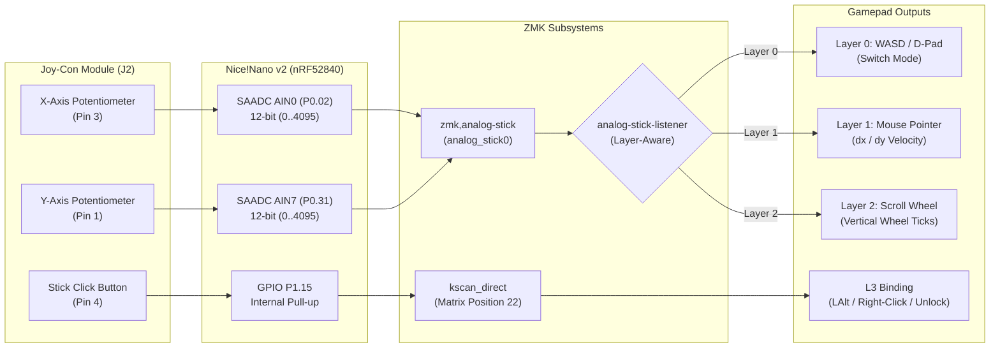

# Gremlin v3 Joy-Con Analog Stick Calibration & Driver Guide

This guide provides complete instructions for calibrating and fine-tuning the Nintendo Switch Joy-Con analog thumbstick on the **Gremlin v3** gamepad using ZMK firmware and the `wdtamagi/zmk-driver-analog-stick` driver.

---

## 1. Hardware Pinout & Architecture

The Joy-Con thumbstick module connects to header **J2** on the Gremlin v3 PCB and is sampled directly by the nRF52840 SAADC (Successive Approximation Analog-to-Digital Converter) on the **Nice!Nano v2**.

| Header Pin | Joy-Con Function | Nice!Nano Pin | nRF52840 Pin | SAADC Channel / Function |
| :---: | :---: | :---: | :---: | :---: |
| **J2 Pin 1** | Y-Axis Wiper | **Pin 21** | `P0.31` | `AIN7` (Channel 7) |
| **J2 Pin 2** | VCC Power | **Pin 21 (Right)** | `VCC` | 3.3V Power Rail |
| **J2 Pin 3** | X-Axis Wiper | **Pin 19** | `P0.02` | `AIN0` (Channel 0) |
| **J2 Pin 4** | L3 Pushbutton Click | **Pin 17** | `P1.15` | Digital GPIO (`kscan_direct`, active-low) |
| **J2 Pin 5** | Ground (GND) | **Pin 3** | `GND` | Ground |



---

## 2. Layer Modes Explained

In [`boards/shields/gremlinv3/gremlinv3.overlay`](boards/shields/gremlinv3/gremlinv3.overlay), the stick behavior automatically morphs depending on the active layer:

1. **Layer 0 (Gaming - `ANALOG_STICK_MODE_SWITCH`):**
   - Physical deflection past the threshold triggers digital keycodes (`W`, `S`, `A`, `D`).
   - Built-in hysteresis prevents rapid on/off key chatter when riding the activation edge.
2. **Layer 1 (Mouse Navigation - `ANALOG_STICK_MODE_MOUSE`):**
   - The stick acts as an analog mouse pointer. Moving the stick farther from center smoothly accelerates the cursor ($1 \dots 20\text{ px/tick}$).
3. **Layer 2 (System / Scroll - `ANALOG_STICK_MODE_SCROLL`):**
   - Stick deflection turns into smooth vertical/horizontal mouse scroll wheel ticks.
4. **L3 Pushbutton Click:**
   - Independent hardware switch. Mapped to `Left Alt` (sprint/crouch) in Game mode, `Right Click` in Mouse mode, and `Studio Unlock` in System mode.

---

## 3. Why Calibration is Required

Joy-Con potentiometers work as voltage dividers. While theoretical values center at $\approx 2048$ (50% of the 12-bit $0 \dots 4095$ range), individual mechanical tolerances vary:
- Neutral rest may sit at `2010` or `2090`.
- Minimum deflection might bottom out at `180` instead of `0`.
- Maximum deflection might peak at `3920` instead of `4095`.

Calibrating ensures:
- **Zero Drift:** The cursor won't creep and WASD won't trigger while resting.
- **Full Range:** You get maximum responsiveness without dead travel at the edges.

---

## 4. Step-by-Step Calibration Procedure

### Step 1: Temporarily Enable USB Logging
In [`boards/shields/gremlinv3/gremlinv3.conf`](boards/shields/gremlinv3/gremlinv3.conf), uncomment lines 54–55:

```ini
# Change this:
# CONFIG_ZMK_USB_LOGGING=y
# CONFIG_ZMK_ANALOG_STICK_LOG_LEVEL_DBG=y

# To this:
CONFIG_ZMK_USB_LOGGING=y
CONFIG_ZMK_ANALOG_STICK_LOG_LEVEL_DBG=y
```

Push this commit to GitHub and flash the resulting `.uf2` firmware to your Nice!Nano v2.

### Step 2: Open a USB Serial Monitor
1. Connect the Gremlin v3 to your PC with a USB-C data cable.
2. Open any serial monitor tool:
   - **Web Browser (No Install):** [serial.control.pro](https://serial.control.pro/) or [webserial.io](https://webserial.io/)
   - **Desktop App:** PuTTY, Tera Term, or Arduino IDE Serial Monitor.
3. Select the COM port corresponding to the Nice!Nano and set baud rate to **115200**.

### Step 3: Record Neutral Center Values
1. Leave the thumbstick completely untouched at rest.
2. Observe the streaming debug logs. You will see lines reporting raw ADC measurements:
   ```text
   <dbg> zmk_analog_stick: x: 2058, y: 2022
   ```
3. Record these resting averages:
   - `x-center` = **`2058`**
   - `y-center` = **`2022`**

### Step 4: Record Minimum & Maximum Extents
1. Slowly push the stick all the way **LEFT** and note the lowest X value:
   - `x-min` = **`185`**
2. Push the stick all the way **RIGHT** and note the highest X value:
   - `x-max` = **`3910`**
3. Push the stick all the way **DOWN** and note the lowest Y value:
   - `y-min` = **`195`**
4. Push the stick all the way **UP** and note the highest Y value:
   - `y-max` = **`3895`**

*(Note: If pushing UP yields low numbers and DOWN yields high numbers, see Inverted Axes below).*

### Step 5: Update `gremlinv3.overlay`
Open [`boards/shields/gremlinv3/gremlinv3.overlay`](boards/shields/gremlinv3/gremlinv3.overlay) and update lines 131–143 with your measured values:

```dts
    analog_stick0: analog_stick0 {
        compatible = "zmk,analog-stick";
        io-channels = <&adc 0>, <&adc 7>;
        x-min = <185>;          /* Your measured full left */
        x-center = <2058>;      /* Your measured neutral rest X */
        x-max = <3910>;         /* Your measured full right */
        y-min = <195>;          /* Your measured full down */
        y-center = <2022>;      /* Your measured neutral rest Y */
        y-max = <3895>;         /* Your measured full up */
        deadzone-percent = <5>; /* 5% deadzone around center */
        wait-period-idle = <100>;
        wait-period-active = <1>;
    };
```

### Step 6: Disable USB Logging (Crucial for Battery Life!)
Once your values are configured, re-comment lines in [`boards/shields/gremlinv3/gremlinv3.conf`](boards/shields/gremlinv3/gremlinv3.conf):

```ini
# CONFIG_ZMK_USB_LOGGING=y
# CONFIG_ZMK_ANALOG_STICK_LOG_LEVEL_DBG=y
```
> [!IMPORTANT]
> `CONFIG_ZMK_USB_LOGGING=y` keeps the USB CDC console running and prevents the nRF52840 from entering deep sleep. Always disable it for regular gaming and wireless battery use.

---

## 5. Fine-Tuning Feel & Responsiveness

All tuning properties live in [`boards/shields/gremlinv3/gremlinv3.overlay`](boards/shields/gremlinv3/gremlinv3.overlay):

### A. Deadzone (`deadzone-percent`)
- **Default:** `<5>` (5% of range).
- **If cursor creeps or sticks at rest:** Increase to `<7>` or `<8>`.
- **If stick feels sluggish to begin moving:** Decrease to `<3>` or `<4>`.

### B. WASD Sensitivity (`switch-activation-point` & `switch-hysteresis`)
Under `layer0` in the overlay:
```dts
layer0 {
    layers = <0>;
    mode = <ANALOG_STICK_MODE_SWITCH>;
    switch-activation-point = <40>; /* Deflection percentage needed to trigger WASD */
    switch-hysteresis = <4>;        /* Prevents flickering at the border */
    up-position = <23>;
    down-position = <24>;
    left-position = <25>;
    right-position = <26>;
};
```
- **Faster twitch response:** Lower `switch-activation-point` to `<30>` (requires only a light nudge to move).
- **Stiffer actuation:** Raise `switch-activation-point` to `<50>` or `<60>` (requires pushing the stick further).
- **If movement rapidly stutters on/off:** Raise `switch-hysteresis` to `<6>`.

### C. Mouse Speed (`mouse-min-speed` & `mouse-max-speed`)
Under `layer1` in the overlay:
```dts
layer1 {
    layers = <1>;
    mode = <ANALOG_STICK_MODE_MOUSE>;
    mouse-min-speed = <1>;   /* Pixels moved per tick at small deflection */
    mouse-max-speed = <20>;  /* Pixels moved per tick at full deflection */
};
```
- For high-DPI desktop screens (1440p / 4K), increase `mouse-max-speed` to `<25>` or `<30>`.
- For micro-precision targeting, lower `mouse-min-speed` to `<1>`.

---

## 6. Troubleshooting Common Issues

### Issue 1: Movement is Inverted (e.g. pushing UP moves DOWN)
If pushing UP produces low numbers and DOWN produces high numbers:
Swap the direction position indices in `layer0`:
```dts
up-position = <24>;   /* Swapped with Down */
down-position = <23>;
```
Or for mouse mode, invert axis calculation by swapping `y-min` and `y-max`.

### Issue 2: Joy-Con Click (L3) Not Responding
1. Check continuity from J2 Pin 4 to Nice!Nano Pin 17 (`P1.15`).
2. Verify that J2 Pin 5 is soldered cleanly to GND.
3. The direct GPIO is active-low: `input-gpios = <&pro_micro 18 (GPIO_ACTIVE_LOW | GPIO_PULL_UP)>;`. If using a custom switch, ensure pull-up is maintained.

### Issue 3: Stick Values Jump Erratically
1. Ensure the FPC ribbon cable is seated firmly and locked squarely into the J2 connector.
2. Verify 3.3V power on J2 Pin 2 with a multimeter.
3. Check for flux residue or solder bridges between adjacent J2 pins (0.5mm / 1.0mm pitch pins are sensitive to flux bridges).
